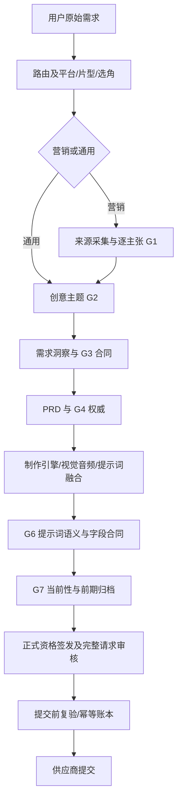

# Edit 通用与营销视频前期管线审计及架构对齐方案

## 覆盖率声明

- 审计基线：`d5ef7a7feaa6a76428503a07937c2215d1ed6538`；任务 `T-2026-1102-0001`，Issue #112。
- 范围内库存 400 文件：完整精读 64，机检/元数据解析 319，抽样 17，未读 0。精读主要覆盖宿主意图、需求/PRD合同、前期装配、提示词质量、修复授权、正式资格与请求绑定。**319 个文件只做完整字节读取、散列、行数、引用清单，未理解其全部实现。**
- 逐文件证据等级、散列、行数、抽样范围见 `outputs/mine-clear/T-2026-1102-0001/coverage.json`。大体量 legacy vendor 的完整生产/剧本实现及 6,617 行 full-chain 脚本主要采用调用点抽样和元数据机检；没有声称全仓逐行审计。采用此裁剪是为了集中验证真实接线、权威传递和高成本提交边界，同时保留可核对的外圈清单。
- 不覆盖成片艺术效果、付费供应商生产实测、前端完整视觉走查、跨仓同步及 276 项 RDAS 全认证。后期用例参加扩展回归不等于本轮对后期做了完整审计。
- A＝源码完整精读；B＝机检、元数据及受控夹具运行；C＝抽样；D＝推断或未验证。下文源码问题标 A，测试结果仅支持夹具内行为；性能收益与方案成效均为 D。

## 本轮判断

**A：当前问题不能简单归因为模型不够强、审核太严。** 至少有三种程序行为会制造无谓失败：合法需求被中途改写；相同规则在生产者与检查者间含义不一致；已审合同没有完整进入最终供应商请求。严格审核接到这种相互矛盾的输入，就可能拒绝一个本来合法的方案。

本轮修复保持现有事实、来源、资格、模型能力及失败关闭机制。没有降低创作规范、关闭质量门、放宽真人通道或自动重渲染。架构部分为待对齐方案，没有实施。

## 实际主链与关键接缝

**A：两路线共用 `VideoStudio` 和 legacy vendor 制作链。** 营销在宿主先准备来源、事实与 G1，再以私有权威传入需求/PRD；通用不应借用营销事实权限。`studio-worker.ts` 仍以一次 `preproduction` 包住整条 vendor 创作，再归档完整镜头和门证据。新控制面的 artifact/gate/repair/invalidation 类型已经存在，但不能把类型或影子投影存在等同于每个节点已由新调度器独立执行。

**A：代码默认开关为 `PIPELINE_COORDINATOR=off`、`PIPELINE_REPAIR=off`、`PROMPT_CONTRACT_V2=off`，系统自动审批默认 enforce。** 这只是源码与 `.env.example` 默认值；本轮没有读取或更改实际部署的秘密配置，也没有把本次合并描述为已开启生产 G6 V2。

## 已修复缺陷与回归入口

| 编号 | 级别/证据 | 触发与影响 | 本轮修复 | 回归文件 |
|---|---|---|---|---|
| MC-001 | P1 / A+B | 普通人物/实物营销被抽象特例抹去对白、场景与摄影；固定竖屏/30fps/禁字幕覆盖客户合同；无许可补 Apache-2.0；事后改镜长与上游来源 | 普通营销不套抽象替换；抽象视觉与声音分别处理；只使用来源绑定主张；画布/帧率/字幕跟随合同；不事后凑镜长或重写上游 | marketing-prompt-contract、marketing-prd-contract、prd-authority-bridge |
| MC-002 | P1 / A+B | “不要叙事片，走营销片”按首个词选错；反向输入也会错误澄清 | 先排除明确否定候选再处理肯定选择 | pipeline-router |
| MC-003 | P1 / A+B | “无人出镜，保留女声旁白”被强制写成无人声 | 视觉无人只约束画面与画内对白；画外声音服从客户原文 | creative-theme-contract |
| MC-004 | P1 / A+B | 并发项目使用首个项目时长上下限/事件回调；非后进先出的清理会拆除另一项目仍需的原型桥 | 每个异步运行隔离参数、事件和日志；静态桥共享引用计数，最后释放才还原 | duration-projection-bridge、studio-compat-concurrency |
| MC-005 | P1 / A+B | 语义示例同时给 pass=true 和失败字段，parser 自拒；示例镜号写死 S01 | 成功示例省略失败字段，失败说明单列，镜号使用本镜合同 | prompt-quality-gate |
| MC-006 | P1 / A+B | enforce 下 G6 已审参考图/画幅/声音/机位未进入最终 wire，默认 CLI 只传时长；caller 可显式覆盖 | 用已验合同补齐现有支持参数及参考图当前字节，验证模型/能力/显式冲突，提交前复验资产，客户端允许认证服务补默认值 | production-authority、production-client、compiled-request |
| MC-007 | P1 / A+B | 单镜台词需 43s、模型最多 30s，旧投影夹成 30s 后仍返回可行 | 明确返回 voice-floor-exceeds-model；执行态不可行阻断，保留原台词和语速 | duration-projection、duration-projection-bridge |
| MC-008 | P1 / A+B | 文本 console tee 与结构化日志把并发工作区内容写入彼此档案；结构化 logger 乱序恢复还会拆桥 | 两通道共同按运行作用域分流；结构化日志单包装、订阅计数、幂等清理；写盘失败不递归镜像自身 | studio-worker 的真实结构化日志并发联动 |
| MC-009 | P1 / A+B | S1 只需修机位、S2 只需修灯光，旧实现把两字段并集授予每镜 | 修复器仅收到并只能改当前镜头失败字段，运行级并集仅作审计摘要 | prompt-quality-gate |

完整基线定位、代码 blob 散列、触发和可执行 argv 在任务台账。源码修复由三名子审计者和主审分别完成，独立验收由未参与对应修改的角色实际执行。尤其 MC-008 首版修复在独立审查中被发现漏掉结构化通道，补齐后才进入最终验收，未以第一轮绿色测试结束任务。

## 已发现未修及有意保留的策略

**A：营销合规词法有误拦。** `vendor/supermickey/hyperreality-system/engines/production-engine/agents/marketing-compliance-guard.js:53` 对【场景】【动作】【台词】直接执行 `body.includes('第一')/('唯一')`。实跑中“第一步打开包装”和“桌上只有唯一一台样机”都被拒绝。代码注释中的法律判断不是本报告的法律结论。

此项本轮**发现未修**：区分动作次序、画面基数、产品比较宣称，以及决定哪些载体允许确定性放行，属于合规与产品检查策略。本轮没有直接删词或弱化对外宣称检查；按用户“大方案先对齐”的要求留待下述约束分类方案处理。回归应同时包含上述两个合法语境及真正的绝对化营销宣称，不能只证明误拦消失。

**A：仍存在主动收窄创作的产品规则。** 无人营销主题会被锚成“商品｜官方自述…”；营销 tone 仅保留四类；各路线注入不得新增客户未提供影片/导演等规则；抽象分支保留固定模板。它们不全是实现 bug，移除会改变产品创作边界，本轮未顺手删除。

**D：本轮没有证明真实通过率或耗时已改善。** 没有使用真实付费 LLM、出图或生视频。不能从几千项单测通过推导“以后一定能出”“P95 降低多少”或“营销内容更精彩”。

## 待对齐方案：把命题作文变成可求解、可选优、可局部修复的创作任务

### 目标、用户与假设

服务同一类使用者：给出意图、素材、人物和营销目标的创作者/业务负责人。他们希望在付费渲染前得到一个满足硬要求、可提交、值得投入渲染成本的完整方案。问题是前期反复生成/审核仍无可提交产物，且一次小问题会破坏已经对齐的内容。

假设：现有模型路由、来源核验、人物授权和付费围栏保留；优先复用现有数据库、ArtifactEnvelope、GateDecision、RepairPlan、requirement/prd/prompt 哈希。没有业务并发量与 SLO 的实测基线，因此不承诺吞吐量、时延或成本下降比例。

功能需求：统一约束来源与优先级；创作前查冲突；允许在合法空间内探索；只修改失败维度；最终请求与已审方案一致。非功能需求：租户隔离、版本固定、可回放、可取消、并发 CAS、统一调用预算、重复请求不再烧渲染费、历史产物只增留痕。

### 三个具体验收场景

1. **通用风景叙事：** “30 秒、无人出镜、女声旁白、克制温暖、16:9。”画面无人不约束画外声音；时长硬检，克制风格作为质量目标。失败的旁白时长只回到台词/分镜分配，不重做已批准场景和画幅。
2. **人物商品营销：** 指定人物、产品外观、已核卖点、不得医疗效果承诺、45 秒、前三秒有钩子。人物和事实是硬约束；钩子、节奏和感染力在满足约束的候选中选优。允许设计场景、比喻与光线，禁止把这些视觉设计写成产品事实。
3. **无人抽象信息片：** 仅抽象界面、已审原文、横屏、60fps、有旁白及字幕。许可证未知则不上屏；字幕由后期精确生成；声音与视觉限制分开；不用“第二镜默认许可证”的模板决定内容。

### 两个候选方案及选择

| 方案 | 内容 | 优点 | 成本/风险/适用前提 |
|---|---|---|---|
| A：在现有阶段上统一约束编译和局部修复 | 编译一次硬/软/适用性合同；每镜失败定向 patch；按依赖失效；当前请求相等性核验 | 能复用现有合同、GateDecision、RepairPlan、哈希与档案；迁移面较小，先消除自相矛盾 | 需要清理多处重复规则所有权；legacy 大阶段仍需拆出稳定接缝；创意天花板仍取决于初稿 |
| B：约束下的多候选构思→择优→逐镜精化 | 在冻结约束后，生成少量低细节候选，只精化选中方案，再走 A 的检查/修复/编译 | 可以从多个可行叙事中比较钩子、表达和视觉新意，降低一次初稿决定全片的风险 | 增加候选状态、选优证据和前期调用预算；可能选优偏好同质化；必须先有质量评测与预算上界 |

**推荐先 A，再评估 B。** A 是修复“为什么同一要求越走越矛盾”的地基；B 负责“在可行空间里怎么更精彩”。不要把 B 的候选数开大来补 A 的接线或规则冲突。以上均未实施。

### 核心流程

`原始意图/素材 → 编译约束集 → 可满足性检查 → 创作分镜 → 确定性编译 → 语义检查 → 定向修复或停滞说明 → 冻结提交包 → 请求等价性与授权检查 → 渲染提交`

- **硬约束：** 人物/素材授权、产品事实与适用限定、客户必须条件、供应商能力、时长与台词可行性、付费额度。任何失败阻断。
- **软目标：** 戏剧张力、钩子、风格偏好、节奏、新颖性。用于候选排序和有限优化，不凭通用审美建议新增硬限制。
- **不适用：** 空镜不需人体微动作，画外声不要求画内口型，未知许可证不生成许可文字；不靠填模板把不适用变成“合格”。
- **艺术虚构与事实分离：** 合法创作可设计场景、动作、比喻；产品性能、价格、评价、效果及承诺必须绑定主张来源。虚构布景不应被当作虚构产品事实，但产品外观等客户锁定项仍是硬条件。

### 数据与接口草案（提案，不是已新增 API）

优先扩展现有 `video_pipeline_artifacts / gate decisions / repair plans`，避免再造平行事实源。是否需要独立表在实施任务中按迁移成本确定。

| 对象 | 必需字段/约束 |
|---|---|
| ConstraintSet | tenantId、workspaceId、projectId、revision、sourceIntentHash、factManifestHash、castManifestHash、modelCapabilityVersion、constraintSetHash；唯一索引(scope,projectId,revision) |
| Constraint | id、sourceRef/sha、authority、hard/soft、dimension、scope(run/scene/shot/field)、appliesWhen、checkOwner、repairOwner、allowedChanges、forbiddenChanges、validatorVersion；规则ID+版本唯一 |
| FeasibilityResult | constraintSetHash、conflicts[]、minimalConflictSet、missingFacts[]、feasible/unverified/conflict；每项给 expected/actual 与来源 |
| Candidate/ShotPlan | candidateId、parentArtifactHash、lockedConstraintHash、shots、scoreVector、blockingFindings、selectionReason；父版本不可覆盖 |
| CheckProof | targetHash、upstreamContextHash、checkVersion、reviewerModelVersion、applicability、result、evidence；缓存键必须包含全部依赖，不按标题或mtime复用 |
| RepairAttempt | baseRevision/baseHash、shotId/fieldPath、findingIds、patch、budgetReservationId、newHash、invalidatedProofIds、accepted/stalled；CAS防并发覆盖 |
| FrozenSubmission | prompt/fields/asset bytes/contract/provider payload hashes、model版本、资格/授权/预算引用、幂等键；媒体提交只消费此冻结包 |

建议业务接口沿现有命令层增加显式操作，路径名称只供讨论：

- `POST /video/projects/:id/constraints:compile`：原始输入引用、expectedRevision、幂等键；返回约束集哈希和冲突。错误 `CONSTRAINT_CONFLICT / FACT_UNVERIFIED / AUTHORITY_CHANGED`。
- `POST /video/projects/:id/preproduction:run`：constraintSetHash、预算 envelope；返回 runId。缺来源保持 blocked，不开始创作调用。
- `POST /video/runs/:runId/repairs:apply`：baseArtifactHash、findingIds、允许字段 patch；返回新版本及失效闭包。错误 `REVISION_CONFLICT / PATCH_OUT_OF_SCOPE / REPAIR_STALLED`。
- `POST /video/projects/:id/submission:freeze`：选中方案及证明；返回 FrozenSubmission 和未满足项；正式 submit 仍走现有认证、权限、围栏、幂等与供应商回执。

### 修复如何保证收敛

1. 检查器必须给 constraintId、shotId、fieldPath、expected/actual、证据和责任阶段，不只说“不够好”。
2. schema/明确算术错误使用确定性修复；语义错误给同一生成模型局部上下文与允许字段；事实缺失返回来源任务，不能靠改写语句掩盖。
3. 每次 patch 保存新版本，校验 forbiddenChanges 和所有相关硬约束；不允许从“改机位”变成“改卖点/人物/时长”。
4. 对没改动的镜头，依赖哈希、检查版本、上游事实/人物版本均相同时复用语义证明；任何依赖漂移立即失效。确定性全量复编译仍保留。
5. 记录失败约束集合和产物哈希；无变化、重复相同状态、跨维度来回震荡、预算不足时明确 stalled，返回最小冲突/未满足项。停止原因可行动，不假称成功。
6. 技术重试、创意修复、来源重查、媒体渲染是不同预算。媒体付费重做继续禁止被普通修复循环隐式触发。

### 异常与并发路径

- **需求互相矛盾：** 创作前返回来源明确的冲突集；程序不自行牺牲客户硬要求。
- **模型超时/非法JSON：** 消耗预留技术重试额度，超限返回 unverified；不把技术不可用误记成创意不合格。
- **修复期间另一版本到达：** expectedRevision/hash 不匹配则409，旧patch不应用到新稿。
- **素材/模型/事实变更：** 沿真实依赖边失效对应证明和提交资格，已成功媒体保持原始回执，不因本轮前期变更自动重付费。
- **提交响应未知：** 保留 unknown 和幂等键，先回查供应商任务；不生成新任务冒险重复付费。
- **取消：** 公共 AbortSignal 和墙钟预算传到所有本轮调用；已发供应商任务按已有对账规则处理，不能仅取消UI投影。

### P0/P1/P2及“不用它会怎样”

| 优先级 | 可验收行为 | 缺少它的实际后果 |
|---|---|---|
| P0 | 硬/软/适用性及来源权威的统一约束编译 | 规则继续相互覆盖，合法创作越走越窄 |
| P0 | 时长/台词/素材/供应商能力创作前可行性检查 | 生成很久才发现根本不可提交 |
| P0 | 单镜单字段修复、CAS和最小失效闭包 | 小修破坏已审事实或全链重跑 |
| P0 | 冻结提交包与wire消费矩阵逐项校验 | 审过的图/参数仍可能没有发给供应商 |
| P0 | 同一run调用/重试/墙钟/成本预留账本 | 局部超时看似有限，总链路仍不可预测 |
| P1 | 严格哈希缓存与有界并发语义评审 | 每次小修重审所有镜头，前期尾延迟持续放大 |
| P1 | 少量低细节候选与有证据的选优 | 只能在一次初稿的局部空间里反复打磨 |
| P1 | 失败维度/耗时/调用数分布与回放样本库 | 只能按体感判断“快了”“更精彩了” |
| P2 | 创作偏好按账号可配置，模板作为参考而非隐含命题 | 不同账号风格继续被统一模板抹平 |

不做：取消事实/授权/付费硬闸；用评分平均抵消一个硬失败；无限候选/无限自修；自动重渲染；为了填25字段添加不适用内容；引入全新通用Agent框架；本轮直接切开关或迁移生产数据；承诺仅靠前期文本保证成片艺术质量。

### 迁移与验收

1. 固定当前可回滚基线，收集真实失败trace及用户判定；通用、人物商品营销、无人抽象营销分别建样本。建议每层至少30件只是评测起点，须按波动和目标计算样本量。
2. 先 shadow 编译统一约束，对照现有路径，记录差异而不改变付费请求。矛盾源逐项归属，不能删除证据让影子结果变绿。
3. 先灰度 A 的可行性与局部修复，再灰度证明缓存/并发，最后实验 B。每一步质量、硬约束漏检与来源一致性均达标才推进。
4. 统计 first-pass/最终可提交率、每个可提交包的调用/token/费用、P50/P95前期耗时、重复修复与stalled比例、人工介入率；按三路线分别报，失败和取消保留在分母。
5. “精彩”用预先定义的钩子/品牌契合/叙事清晰/视觉新意量表和盲评配对，不拿模型自评当业务效果。真实投放转化是后续经营实验，不能由文本审计推导。
6. 回滚只切换版本化策略和已有feature flag，保留原始档案/决策；不得回写已签发的历史证明。

### 外部依据与适用边界

Anthropic 的工作流文章支持对明确任务使用可组合流程，并提醒复杂Agent的成本/延迟权衡；不证明 Edit 应采用某个具体框架。[Building effective agents](https://www.anthropic.com/research/building-effective-agents)。Self-Refine 展示了反馈精化模式，但其任务与统计不能直接外推到视频创作。[Self-Refine](https://arxiv.org/abs/2303.17651)。多次试验、完整轨迹及多种grader的评测口径可参考 [Demystifying evals for AI agents](https://www.anthropic.com/research/demystifying-evals-for-ai-agents)。本提案来自当前代码接缝与问题证据，收益仍待本系统实测。

## 收尾报告

- 已完成：目标链路审计、9组缺陷最小修复、先验复现与回归、并发及提交边界独立复核、将新增断言接入现有CI；完整方案与边界文档。
- 未完成/未覆盖：合规语境策略与创作架构按用户要求等待对齐；真实模型产出率/延迟、成片质量和RDAS生产认证未验证。云端集成与最终运行回执由本次PR/Issue及交付报告另行绑定，不能由本文的存在推定完成。
- 自主追加事项及理由：并发日志两通道隔离、真实原型生命周期用例、正式CLI合同参数补齐、将新回归加入CI，均直接保护本次前期链路。
- 采用的假设：视觉无人不等于无旁白；普通营销不隐含抽象模板；本轮研发授权不等于真实付费渲染授权；代码默认值不等于部署实际值。
- 置信度：已修实现缺陷高，有源码和正负回归；全系统无其他缺陷不能保证；真实效率/创意收益未验证。
- 建议复核：人物实物营销的原始意图与G6稿；无人+旁白+60fps字幕合同；G6资产/参数与最终请求逐项绑定。

## 自检表

- [是] 覆盖声明的两路线前期及提交边界，精读、机检、抽样与生产未验证分别披露，没有以外圈库存冒充理解。
- [是] 自主完成已授权修复、验证和CI接入；大方案按用户要求保留为待对齐提案。
- [是] 源码、受控测试与未来收益分级；每个已修问题有基线和可执行回归。
- [是] 修改接受独立审查，首轮遗漏被追查并补齐，未以单次测试绿色代替边界验收。
