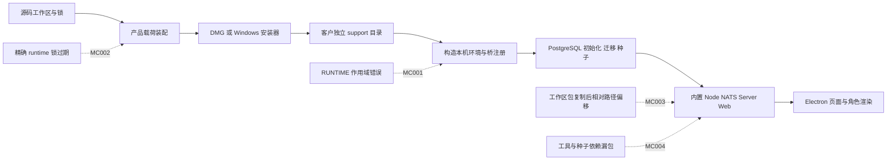
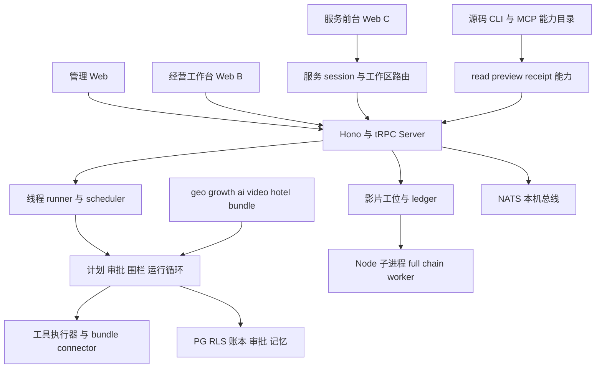

## 覆盖率声明

- 范围内文件总数：**3104**，其中审计基线跟踪文件 3102 个，新增客户端修复源文件 2 个；**精读 92，机检或脚本解析 2772，抽样 6，未做内容阅读 234**。四类按最佳证据互斥，合计 3104。
- 基线的 2868 个文本文件接受全量元数据、语法或候选模式扫描；新增两个 helper 文件完整阅读并实际运行语法与回归测试。全量机检与精读/抽样有重叠，不能再把这些数字相加。机检不等于通读，也不证明全部功能正确。
- 234 个二进制文件仅核对存在、大小、类型与哈希，没有逐张检查图片或逐件理解内容。打包后的 Mach-O 另有静态装载图检查，属于 B 级，独立于这 3104 个源码文件的统计。
- 采用“全量机检加关键链路精读”：重点完整阅读认证、租户上下文、主路由、运行循环、授权、审批、队列、影片工位、客户端引导、打包与发布入口。其余业务页、全部连接器和超长成片脚本没有全量逐行精读。裁剪原因是本任务既要审计近期迭代，也要实际解决客户客户端启动失败；精读优先覆盖可阻断交付和突破不变量的调用链。
- 完整逐文件分类、读取行数、区间和基线/交付哈希见 [文件覆盖率清单](file-coverage.csv)；未精读清单就是该表中 B/C/D 行，没有隐藏未读项。摘要见 [coverage-summary.json](coverage-summary.json)。

| 抽样文件 | 已读行数与范围 | 文件总行数 | 裁剪原因与结论边界 |
|---|---|---:|---|
| apps/server/src/service/e2e.test.ts | 200，1–200 | 1044 | 阅读认证与连接夹具；实际运行对应 PG 测试，不据此声称理解其余测试逻辑 |
| apps/server/src/trpc/accounts-router.ts | 200，1–200 | 587 | 读取账户入口；本次没有真实供应商账户操作，余额/全账户行为未完整审查 |
| apps/server/src/video/production-authority.pg.test.ts | 135，1–135 | 257 | 读取授权用例前段；运行测试不替代剩余内容精读 |
| packages/runtime/src/runtime.test.ts | 181，112–292 | 292 | 读取围栏与运行测试后段；新增健康断言直接走真实实现 |
| scripts/tools/compose-film.mts | 28，23–50 | 549 | 追踪直接依赖；合成成片与全部失败分支未生产实测 |
| scripts/tools/full-chain-film.mts | 435，1–155、2076–2225、4791–4920 | 8160 | worker 入口、G5 审查、配音关键段；不把 435 行阅读写成全脚本通读 |

**证据分级**：A＝完整阅读相关实现后得出；B＝全量机检、元数据或结构解析得出；C＝局部源码或 UI 抽样得出；D＝推断或未验证。实际测试结果另外列明。A 也不代表所有平台/客户环境均通过。

# WorkLoom Growth 深度审计与客户端启动修复报告

读者：产品负责人、客户端交付负责人和后续修复工程师。任务号：`T-2026-1002-0901`。日期：2026 年 10 月 2 日。执行：Codex 本会话；没有使用子代理，没有上传敏感发现或给其他聊天发送消息。

本任务覆盖对 [固定审计基线](baseline.json) 的静态、动态、联动和交付面检查，以及用户追加授权的 Mac/Windows 客户端启动修复。业务审计是诊断，客户端是实际修复；下面逐项列出发现未修的业务问题。

## 当前交付判断

**Mac arm64 客户端的已复现启动阻断已经修复，并从实际 DMG 安装后完成首启、重启、升级、默认渲染和安全渲染。Windows 的共用启动代码、载荷装配与目标依赖安装已处理，但没有 Windows 真机与所需完整原生载荷，不能声称 Windows 客户端已经运行通过。**（A：源码修复；安装实测：本机 Mac arm64；Windows 执行：D）

**整体正式客户经营交付仍被 3 个未修 P0 阻断。** 它们是生产公共登录、动作先执行后授权、缺参/相关性标记绕过不可审批红线。Mac 能打开应用，不足以证明客户真实数据、真实发布或交易安全。（A，MC-005/006/007）

本次共 **16 个问题卡：P0 3、P1 10、P2 3；客户端 4 个已修，业务与治理 12 个未修**。另有 6 张修复实施/排期卡。已修状态为 `fixed`，没有冒充独立验收的 `verified`。MCD 执行器字段校验没有错误；发布门禁明确红在 3 个 P0。原有 `release:gate` 的 11/11 通过只覆盖规则/mock/人工挂起路径，不能抵消真实实现上的 9 条健康断言失败。（A/B，见 [机器可读台账](ledger.json)、[台账门禁原文](../artifact-index.json)（原件未包含，见索引））

### 三条基线和代码归属

| 事项 | 实际值 | 证据 |
|---|---|---|
| CNB 审计 main | `42ead347c65a5cc343bcd290702d53a7fcdb1687` | 匿名 fetch/ls-remote；2026-10-02 11:26 +08 再核对无漂移 |
| 客户端修复提交 | `5d0c83e3293dc3a71651210987c9a5b48023480d` | 本地分支 `task/T-2026-1002-0901`，11 文件，380 增/143 删，工作树 clean |
| 独立验收基线 | 未建立 | 3 P0 未闭环；没有进入整体 M6/RDAS 生产验收 |
| 原舰队镜像 | main `badbe6fcbe141930b8c000933f36b9d6b4c264c4`，clean | 只用于 fetch 和独立工作副本，不覆盖原 main |
| 远端状态 | 修复尚未 push、未建 PR/公开 Issue | 可用本地提交、补丁和只含变更文件的源码 ZIP 复核 |

基线核对执行器仍给 4 张已修卡 `needs-relocate`，因为其 `root_cause` 有意保留 42ead347 的历史失败位置。台账已另写当前修复位置 `repair_evidence@5d0c83e`；12 张未修问题的根因文件在新提交中均未变，核对为 `current`。这 4 项不是新业务缺陷，也不是独立验收通过证明。（B，[evidence/mine-clear-baseline-final.log](../artifact-index.json)（原件未包含，见索引）、[evidence/final-source-state.json](../artifact-index.json)（原件未包含，见索引））

## 客户端为什么源码能跑而客户包不能跑

这次故障有四个相互叠加的根因。开发机的工作区链接、源码位置和工具链掩盖了包中的装配错误；仅在仓库里运行 Web 和单测不能证明安装包自包含。（A，MC-001–004）



- **MC-001，A**：`buildDesktopEnvironment` 在函数作用域外引用 `RUNTIME`。原单测直接抛 `ReferenceError`；首启环境构造到此就停止。现在由调用方显式传 `runtimeDir`，并要求绝对路径。
- **MC-002，B**：每产品精确依赖 manifest/指纹未跟当前源码更新，打包 `verify` 在载荷安装前失败。现在用现有刷新器对齐实际依赖与输入；根 pnpm 锁没有另作升级。Vite 和 React 插件版本变化来自现有仓库版本，不代表选择“最新版本”。
- **MC-003，A**：把工作区源码复制进 `runtime/node_modules/@...` 后，其 repo 相对 `bundles` 路径偏移，且可能产生第二份模块实例。真实首启 `shot-intent` 导入失败，服务健康检查超时。现在源码留在 `runtime/packages`，生成无软链的 ESM 重导出入口。
- **MC-004，A**：全链工具导入的 `film-voice-artifact` 未装入；备线还遗漏 `skill-bindings`、部分工具与行业契约 dist。现在主线与备线补文件白名单和自检。修复后工具成功加载，到达其当前明确的 `WORKER_MODE_NOT_WIRED` 守卫；影片业务能力仍未实现。

### 客户端修复方案比较和选定理由

| 方案 | 优点 | 成本和风险 | 适用前提 | 本次选择 |
|---|---|---|---|---|
| 保留原源码位置，生成受控 ESM 重导出入口 | 保持 repo 相对文件关系和单例；兼容无软链 tar/Windows 文件复制；改动集中在已有打包流程 | 当前 helper 明确拒 default、通配和 CJS exports；新包形式需扩展实现与测试 | 当前工作区包具有受支持的 named ESM exports | **选定并实施**；针对真实根因，11 个文件即可闭环 Mac 首启 |
| 把服务、脚本和所有工作区包预编译/打包成统一 JS 发布树 | 能逐步收紧源码动态加载、减少运行期转换 | 动态 bundle 文件、SQL迁移、工具脚本、资源路径和外部子进程都需重新建发布契约；改动面大，可能造成新的漏包 | 有独立运行资产清单和端到端发布测试 | 留作后续演进；本次没有用大范围重构替代客户启动修复 |

两种方案都必须维护精确依赖、资源闭包、目标平台原生资产和真实安装测试。源码成功构建不能替代这些条件。（A：现有打包实现；成本判断 D）

### 具体实现和异常路径

`buildDesktopEnvironment(text, options)` 增加内部参数 `runtimeDir`；公共业务 API、数据库表和客户数据格式未改。错误路径为非绝对目录直接抛可定位错误。桥模块依照安装 runtime 定位，已有用户配置保留回归用例。（A，`apps/desktop/electron/bootstrap.cjs:371@5d0c83e`）

`scripts/pack-workspace-modules.mjs:14@5d0c83e` 读取当前 runtime 中的工作区 manifest，先验证 ESM/exports、目标存在、路径不越界和包名不重复，再生成 facade。入口重导出 canonical 源文件，不复制源码。条件/types/subpath exports 在允许范围内处理；尚未实现的形式在打包时拒绝，避免静默形成客户坏包。测试包含原复制布局确实失败、中文空格路径重定位、单例相同、缺文件、越界和重复冲突。（A）

`pack-electron-payload.sh`、`pack-macos.sh`、`pack-windows.sh` 共用 helper，补齐工具与种子文件。`package.json` 新增 `test:desktop`，并接入 `test:scripts`；没有修改 `.cnb.yml` 等治理文件。精确锁一并刷新。全部 11 个改动文件列于 [产物清单](../artifact-index.json)（原件未包含，见索引），源码与补丁中不包含审计 `.env` 或客户凭证。（A/B）

## 系统现状和能力成熟度

Growth 属于隔离实验车道。这里看到的行业、增长与影片语义不能直接改写基座或 Andromeda 的事实源。本次保持该边界，没有向其他仓回流代码或替平台中枢配置秘密。（A：仓产品上下文与 AGENTS）



架构依据为完整阅读的 `apps/server/src/index.ts`、`trpc/context.ts/router.ts`、`runtime/thread-runner.ts/scheduler.ts/tool-executor.ts`、`packages/runtime/src/loop.ts`、`packages/base/workdata/gateway.ts`、影片 worker/ledger 和产品运行脚本。图表示本次核对的调用关系，不表示每条连接器已经真实经营交付。（A）

| 面向用户的能力 | 本次实际证据 | 成熟度判断与边界 | 等级 |
|---|---|---|---|
| 客户安装后看到经营工作台 | DMG 实际首启、角色渲染、任务页面 | Mac arm64 本机可启动；其他机器/平台与正式签名仍未验 | A＋实际安装；外推 D |
| 问答、建立任务、人工审批挂起 | release:gate 11/11，PG 单测，新增实作断言 | 基础结构可跑；授权、重放、编辑、并发出现实证缺陷，不能承诺全自主 | A/B |
| GEO 围栏与对象模型 | suite:geo 80/81，缺 publish_job 映射 | 规则集合有模型漂移；真实平台发布/获客效果未测 | B，真实效果 D |
| 浏览器移动经营与服务前台 | 390×844 的 B/C 真实点按与截图 | 示例登录、首页/任务、服务连接、mock 咨询草稿可见；全 UI 状态没有穷尽 | C |
| CLI/MCP 经营能力目录 | CLI22条、21启用，MCP21工具，真实 initialize/tools list | 是源码接入；read15/preview3/receipt3，execute1 为禁用项。条目数不是经营闭环数 | A/B |
| 影片生产工位 | start/status 原生 child 导入失败；有 loader 后 worker 明确未接线 | 此入口未闭环，0组件；“载荷不再漏模块”不等于“可交付成片” | A/C |
| 真人 portrait 和统一配音 | portrait-agent、decision、first-pass、voice-artifact 完整阅读；full-chain 局部阅读 | 有实现与保护设计；未用真人素材、生产模型、真实供应商生成验证 | A/C；生产结果 D |
| 默认演示经营数字 | 页面明确“演示数据”；release mock 与种子 | 截图内自主完成/在岗数字是种子演示，不是本次查得的真实经营绩效 | C |

### 三个客户场景与当前边界

1. **新客户安装试用**：下载安装器，用中文用户名/目录首次打开，不安装 Node/PG。P0 是应用能完整起本机服务并进入正确产品；不用这条就无法试运行。本次 Mac 实装达到此项，Windows 未证实。P1 是关闭后重启、升级保留数据和失败恢复；已测重启与旧QA数据目录升级后仍可启动，没有逐表比对数据，任意客户历史数据与失败恢复未穷尽。P2 是引导、角色与手机页面好用；做了样本走查，未做全页面视觉回归。（A/C/D）
2. **老板批准一项带写动作的任务**：必须在动作发生前看到最终参数和风险，批准最多执行一次。否则错金额、错收件人或重复执行已发生，事后拒绝落账没有保护作用。MC-006/007/008/009 是这条流程当前的交付障碍；本次只在本地计数连接器安全复现。（A）
3. **影片经营人员让系统产出一阶段组件再归档**：入口应报告是否支持、可加载工位、预算与组件回执。否则 UI 显示 running 后 failed，用户无法区分素材、环境还是未实现。MC-013 说明当前入口尚不能完成这条核心流程；真实成片与经营投放不在本次验证结果中。（A/C/D）

本次不新增产品功能，不把演示工具扩写成真实供应商连接器，不迁移客户数据库，不改所有审计缺陷，不做真实发布/群发/投放，不承诺无人值守真实经营。这些边界均有对应证据和后续排期，没有用未声明裁剪代替交付。

## 实际验证结果与用例范围

环境：隔离 `growth_audit` PostgreSQL；56 条迁移与模拟种子；源码服务仅 loopback；所有供应商 key 清空，模型 mock；实际安装的 Mac 应用使用独立中文空格 support 目录与独立端口。没有读取原舰队镜像的真实 `.env`，没有触发真实客户动作。Node/pnpm/Electron 与下载资产依据现有仓库/官方元数据锁定，见构建日志；不是最新版推荐。（A/B）

### 构建、数据库和门禁

| 验证 | 前置条件与步骤 | 预期 | 实际结果 | 证据与解释 |
|---|---|---|---|---|
| typecheck | 冻结依赖；pnpm typecheck | exit0 | exit0，42.962s | [evidence/typecheck.json](../artifact-index.json)（原件未包含，见索引）；类型通过不保证运行安全 |
| 默认主测试 | pnpm test，默认 DB 开关 | 记录通过和跳过 | 3392通过、318跳过；249文件通过、14文件跳过 | [evidence/unit-tests.log](../artifact-index.json)（原件未包含，见索引）；不能宣称DB全面通过 |
| Server PG 测试 | RUN_DB_TESTS=1，隔离种子工作区 | 真库权限/业务回归通过 | 975通过、1跳过 | [evidence/pg-server-tests.log](../artifact-index.json)（原件未包含，见索引） |
| Base PG 测试 | 真库、独立工作区夹具 | 真库回归通过 | 1368通过 | [evidence/pg-base-tests.log](../artifact-index.json)（原件未包含，见索引） |
| Runtime PG 测试 | 真库 | 运行测试通过 | 73通过 | [evidence/pg-runtime-tests.log](../artifact-index.json)（原件未包含，见索引） |
| 脚本门禁 | pnpm test:scripts | 所有链上的命令实际完成 | 249 Vitest＋12 Node＋70 desktop通过 | [evidence/scripts-tests-final.log](../artifact-index.json)（原件未包含，见索引） |
| Desktop 回归 | pnpm test:desktop | 新错误路径及既有门禁通过 | 70通过、0失败、0跳过 | [evidence/desktop-tests-release-candidate.log](../artifact-index.json)（原件未包含，见索引） |
| 三 Web 构建 | 已建行业契约，分别构建 Web/B/C | 三构建exit0 | 全部exit0 | [evidence/build-web.json](../artifact-index.json)（原件未包含，见索引）、[evidence/build-webb.json](../artifact-index.json)（原件未包含，见索引）、[evidence/build-webc.json](../artifact-index.json)（原件未包含，见索引） |
| GEO suite | 隔离源码环境，pnpm suite:geo | 81项通过 | 80/81，A-10失败 | [evidence/suite-geo.log](../artifact-index.json)（原件未包含，见索引），MC-014 |
| 现有 release gate | RELEASE_WORKSPACE_ID=ws-geo，规则/mock | 11项通过 | 11/11 | [evidence/release-gate-geo.log](../artifact-index.json)（原件未包含，见索引）；未走真实模型与供应商 |
| 新健康断言 | 真实PG/runner/decide/scheduler；本地计数连接器 | 权限、审批、终态和队列不变量成立 | 9/9不健康，--assert exit1，无夹具异常 | [evidence/runtime-health-assert-final.json](evidence/runtime-health-assert-final.json)，详见问题卡 |
| 生产登录断言 | production服务、随机签名密钥、非示例假资产 | 匿名不能获owner | 200/owner/保护接口200，断言exit1 | [evidence/production-login-nonexample.json](evidence/production-login-nonexample.json)，MC-005 |
| MCD 台账门禁 | 16问题＋6修复卡，12不变量 | 字段校验；P0未闭环应红 | 字段错误0，3项P0阻断，exit1 | [evidence/mine-clear-gate-final.log](../artifact-index.json)（原件未包含，见索引） |

各组 PG 测试与默认测试有大量重复，**不把重跑计数相加为唯一测试数量**。单测绿和新实作断言红同时存在，说明既有用例缺少这些真实时序/语义边界；没有篡改预期来获得绿结果。（B）

### Mac 安装包与渲染专项

| 用例 | 前置条件与步骤 | 预期 | 实际 | 证据 |
|---|---|---|---|---|
| 首装 | 真DMG只读挂载，拷出.app；空中文空格support；APP_SMOKE | 解包、随机角色凭据、PG迁移/seed、NATS/Server/Web起，退出0 | 通过，40.394s | [evidence/dmg-install.json](../artifact-index.json)（原件未包含，见索引）、[evidence/installed-app-first.json](evidence/installed-app-first.json) |
| 重启 | 同support再次APP_SMOKE | 复用数据并通过服务健康检查 | 通过，7.082s | [evidence/installed-app-restart.json](../artifact-index.json)（原件未包含，见索引） |
| 升级 | 用旧QA载荷建立的隔离support启动新版本 | 重装runtime且保持测试库可用 | 通过，32.432s | [evidence/installed-app-upgrade.json](../artifact-index.json)（原件未包含，见索引）；不是客户任意旧版本迁移证明 |
| 默认角色渲染 | 已装.app，RENDER_SMOKE | live2d-webgl，产品与avatar ready、参数写入无失败 | 通过，29.130s | [evidence/render-default.json](../artifact-index.json)（原件未包含，见索引） |
| 安全渲染首装 | 另一个全新support，SAFE_RENDERING=1 | vector2d，产品/avatar/职场 ready | 通过，70.814s | [evidence/render-safe.json](../artifact-index.json)（原件未包含，见索引） |
| 正常页面点按 | 实际启动后的工作台；推迟首日引导，进入任务页面 | 正确产品内容与本机服务读取的演示任务页可见 | 样本通过，1280×720 viewport无横向滚动 | [evidence/ui-walkthrough.json](../artifact-index.json)（原件未包含，见索引）、下面全页面截图；C级 |
| 影片模块闭包 | 已装runtime＋内置Node＋--import=tsx，仅--worker | 无ERR_MODULE_NOT_FOUND，到已知worker守卫 | healthy=true；底层worker预期exit1 | [evidence/packaged-film-load-result.json](evidence/packaged-film-load-result.json)；不是影片成片成功 |
| 原生启动装载图 | Node、postgres/initdb/psql、vector.dylib、nats六入口 | 启动可达依赖无未解析项 | 可达15个Mach-O，未解析0 | [evidence/native-startup-closure.json](../artifact-index.json)（原件未包含，见索引），B级 |

完整载荷扫描 267 个 Mach-O 元数据，另有 34 项未解析候选，集中在不在本次启动图的 ICU 辅助库和 Python 扩展。扫描忽略进程库搜索环境和可选扩展实际调用，不能把 34 项都说成启动失败，也不能说全部原生功能已验证。Mac Intel、另一台干净机器、Windows DLL ABI 未验证。（B/D）

渲染探针的 `workplace.ready=true` 只证明底层 DOM/角色/像素信号。实际看图发现首日引导曾覆盖场景，本次又用真实点按推迟引导进入工作台；没有把探针当成无遮挡的全视觉验收。浮动数字人可能遮住首页部分消息，作为 C 级体验观察留待补测，不混进 16 个已上账根因。（C）


### 移动页面抽样

B、C 均以 390×844 实际浏览器 viewport 点按。B 体验身份、首页和任务列表无横向溢出；C 配置隔离工作区和随机服务签名密钥后连接成功，本地 mock 咨询返回“工单草稿尚未提交”。没有发给真实客户。初次 C 失败是测试服务在 production 下没有 SERVICE_C_SECRET，符合其拒开发占位策略；不列为产品缺陷。（C，[evidence/ui-walkthrough.json](../artifact-index.json)（原件未包含，见索引））


### 五维覆盖和未覆盖

| 维度 | 已测的具体输入/时序 | 结果 | 尚未覆盖 |
|---|---|---|---|
| 正常 | 首启/重启/旧QA升级、两种渲染、规则问答与人工挂起、源码CLI/MCP握手 | 客户端专项通过；业务mock结构通过 | 真实供应商、模型、真实经营成片/发布回执 |
| 边界 | 空support、中文空格目录、exports缺失/越界/冲突、0running+10queued、金额编辑1→2、两个工作区同原因 | 客户端回归通过；队列/编辑/跨区记忆失败 | 最大磁盘/内存、长路径极限、大数据和长时间容量 |
| 错误 | 基线作用域错误、锁过期、漏模块、工位失败、缺服务秘密、审批拒绝、无权限动作 | 明确复现与分类，没有吞异常 | 断电、磁盘满、任意升级中断、全部客户坏环境 |
| 权限 | production匿名owner、无bindings、一次性审批并发、block加flag再批准 | 全部失败，P0未修 | 真实客户多机/公开网络渗透、全部角色与PII路径 |
| 回归 | 类型、主测试、三个PG组、脚本链、70desktop、三Web构建、真实DMG矩阵 | 已实际执行，计数见表 | Windows/Intel/签名公证、跨仓舰队完整验收 |

这里没有写出未跑平台的“实际结果”。对未覆盖项明确写 D，而非用测试数量推导通过率。

## 问题总表

| 编号 | 级别 | 层 | 状态 | 问题 | 证据 |
|---|---|---|---|---|---|
| MC-001 | P1 | L1 | 已修、本会话回归 | 桌面环境构造引用作用域外的 RUNTIME，首次启动抛异常 | A |
| MC-002 | P1 | L2 | 已修、本会话回归 | 客户端精确依赖锁未随仓库实际依赖更新，载荷门禁失败 | B |
| MC-003 | P1 | L2 | 已修、本会话回归 | 工作区源码复制进 node_modules 后破坏相对路径与模块单例 | A |
| MC-004 | P1 | L2 | 已修、本会话回归 | 载荷漏影片辅助模块，备线遗漏种子与白板工具依赖 | A |
| MC-005 | P0 | L1 | 发现未修 | 生产环境公共 loginAs 无身份验证，非示例工作区可取得 owner 身份 | A |
| MC-006 | P0 | L3 | 发现未修 | 外部动作先执行后授权，审批并发可产生重复副作用 | A |
| MC-007 | P0 | L1 | 发现未修 | 缺参和低相关性标记跳过全部围栏，人工审批可越过 block 红线 | A |
| MC-008 | P1 | L3 | 发现未修 | plan_unverified 在存计划之后才标记，重放可绕过未批准的审核 | A |
| MC-009 | P1 | L4 | 发现未修 | 编辑后采纳只记录新值，实际工具继续执行原参数 | A |
| MC-010 | P1 | L3 | 发现未修 | 把 queued 算进运行并发，十条待办且零运行时队列停滞 | A |
| MC-011 | P1 | L3 | 发现未修 | 已驳回的 cancelled 线程可被普通 run 重新挂起 | A |
| MC-012 | P1 | L3 | 发现未修 | 驳回记忆 ID 不含工作区，同原因在第二工作区导致审批回滚 | A |
| MC-013 | P1 | L2 | 发现未修 | 影片工位子进程缺 TypeScript 加载器，worker 分支仍未接通 | A（worker）/C（8160行CLI） |
| MC-014 | P2 | L2 | 发现未修 | GEO 围栏引用 publish_job，组合对象模型没有该类型 | B |
| MC-015 | P2 | L4 | 发现未修 | 影片预览建议命令未转义用户字符串，中文路径和分号破坏参数 | A |
| MC-016 | P2 | L2 | 发现未修 | Live2D 间接工具链含四个安全公告，需按实际可达面处理 | B |

L1 是代码逻辑层，L2 是配置/装配层，L3 是时序/并发运行层，L4 是结果语义层。级别按本仓不变量与实际触发结果判定；间接依赖公告的 registry critical 不直接变成本项目 P0。

## 逐项问题卡与可运行断言

断言均在指定源码仓根目录执行。涉及 PG 的脚本要求已迁移并 seed 的 **loopback growth_audit** 测试库，否则直接拒绝。所有工具副作用用随附本地计数连接器。命令中 `.env` 指独立审计夹具，不能用客户真实 `.env`。`--assert` 的 exit1 表示当前缺陷仍在；这些红结果是交付证据。

### MC-001 桌面环境构造引用作用域外的 RUNTIME，首次启动抛异常

**P1 / L1 / 已修 fixed；证据 A。**

根因定位：`apps/desktop/electron/bootstrap.cjs:395@42ead347c65a5cc343bcd290702d53a7fcdb1687`，`buildDesktopEnvironment`。

前置与复现步骤：在初装/重建环境时调用 buildDesktopEnvironment；执行原 bootstrap.test.cjs 环境构造用例即可复现。

预期：返回数据库与服务配置，桥模块按安装后的 runtime 绝对目录解析，无 ReferenceError。

实际：基线测试 exit 1，ReferenceError: RUNTIME is not defined；修复后同测试和真实 DMG 首启 exit 0。

对应不变量：INV-3, INV-5。修复方向：显式传入 runtimeDir，校验其为绝对路径，bootstrap 调用方传入本次运行目录。

联动面：环境重写、中文路径、桥注册和已有配置保留共同受影响；不能只移除桥解析以躲过异常。

状态说明：本地修复并完成本会话回归。Mac arm64 安装实测；Windows 安装与执行、Mac Intel、第二台干净机器未验证。fixed 不代表独立 M6 verified。

当前修复定位：`apps/desktop/electron/bootstrap.cjs:371@5d0c83e3293dc3a71651210987c9a5b48023480d`。

断言 1（sample）：环境构造用例通过且桥模块路径来自传入目录；本次结果 **pass**。

```bash
node --test apps/desktop/electron/bootstrap.test.cjs
```

复现输出：[evidence/desktop-bootstrap-before.log](evidence/desktop-bootstrap-before.log)、[evidence/desktop-bootstrap-after.log](evidence/desktop-bootstrap-after.log)、[evidence/installed-app-first.json](evidence/installed-app-first.json)。

### MC-002 客户端精确依赖锁未随仓库实际依赖更新，载荷门禁失败

**P1 / L2 / 已修 fixed；证据 B。**

根因定位：`.workloom-runtime-deps/metadata.json:28@42ead347c65a5cc343bcd290702d53a7fcdb1687`，`runtime-deps-lock verify 输入指纹`。

前置与复现步骤：基线运行 node scripts/runtime-deps-lock.mjs verify；装配脚本在依赖 stage 前检查当前产品精确 manifest。

预期：锁中的 manifest 和输入指纹与产品源码一致，verify exit 0。

实际：基线 exit 1，runtime 精确 manifest 已过期；按仓库实际依赖刷新后 exit 0，Windows x64 目标安装 58 个包成功。

对应不变量：INV-8, INV-12。修复方向：通过现有刷新器重建每产品精确 manifest、package-lock 与输入指纹，保持根 pnpm-lock；未另起一套依赖源。

联动面：根 package.json 的门禁脚本变化也改变指纹；打包、更新、各平台原生可选包安装共同依赖此锁。

状态说明：本地修复并完成本会话回归。Mac arm64 安装实测；Windows 安装与执行、Mac Intel、第二台干净机器未验证。fixed 不代表独立 M6 verified。

当前修复定位：`.workloom-runtime-deps/metadata.json:28@5d0c83e3293dc3a71651210987c9a5b48023480d`。

断言 1（sample）：verify exit 0，输入指纹与当前产品一致；本次结果 **pass**。

```bash
node scripts/runtime-deps-lock.mjs verify
```

复现输出：[evidence/runtime-lock-baseline.log](evidence/runtime-lock-baseline.log)、[evidence/runtime-lock-verify-final.json](evidence/runtime-lock-verify-final.json)、[evidence/runtime-lock-stage-windows-fixed-env.json](evidence/runtime-lock-stage-windows-fixed-env.json)。

### MC-003 工作区源码复制进 node_modules 后破坏相对路径与模块单例

**P1 / L2 / 已修 fixed；证据 A。**

根因定位：`scripts/pack-electron-payload.sh:127@42ead347c65a5cc343bcd290702d53a7fcdb1687`，`内部工作区包实体注册循环`。

前置与复现步骤：按原脚本打包，再从独立 support 目录启动；视频包从 node_modules 的复制位置解析 ../../../bundles。

预期：安装 runtime 保留源码相对路径，同一个工作区模块只有一个实体实例，服务健康检查通过。

实际：首个完整载荷启动因 shot-intent.mjs 的 bundles 路径偏移而 ERR_MODULE_NOT_FOUND，健康检查超时；新载荷真实安装启动成功。

对应不变量：INV-5, INV-12。修复方向：保留 packages 原位置，在 node_modules 生成 ESM 重导出入口；三个打包脚本共用新 helper。对不支持的 default、通配和 CJS exports 失败关闭。

联动面：行业契约 dist、跨包相对依赖、重复包名、条件 exports、模块状态单例和中文空格重定位均需检查。

状态说明：本地修复并完成本会话回归。Mac arm64 安装实测；Windows 安装与执行、Mac Intel、第二台干净机器未验证。fixed 不代表独立 M6 verified。

当前修复定位：`scripts/pack-workspace-modules.mjs:14@5d0c83e3293dc3a71651210987c9a5b48023480d`。

断言 1（sample）：5 个回归用例通过，旧复制布局的相对路径失败被复现，入口重导出保持同一实例；本次结果 **pass**。

```bash
node --test scripts/pack-workspace-modules.test.mjs
```

复现输出：[evidence/packaged-bootstrap-first.log](evidence/packaged-bootstrap-first.log)、[evidence/desktop-workspace-regression.log](evidence/desktop-workspace-regression.log)、[evidence/installed-app-first.json](evidence/installed-app-first.json)。

### MC-004 载荷漏影片辅助模块，备线遗漏种子与白板工具依赖

**P1 / L2 / 已修 fixed；证据 A。**

根因定位：`scripts/pack-electron-payload.sh:91@42ead347c65a5cc343bcd290702d53a7fcdb1687`，`Film CLI 文件白名单`。

前置与复现步骤：使用原独立安装 runtime 加 tsx loader 调用 full-chain-film.mts --worker；Mac/Windows 备线装配种子和工具。

预期：工具导入闭包完整；已知未实现的 worker 分支返回 WORKER_MODE_NOT_WIRED，而非模块缺失；所需种子与契约 dist 随包。

实际：旧独立 runtime 缺 film-voice-artifact.js，ERR_MODULE_NOT_FOUND；新 DMG runtime 无缺模块并到达 worker 守卫。备线 skill-bindings、Windows 工具白名单与 Mac dist 已补，备线整包未实跑。

对应不变量：INV-5。修复方向：补 film-voice-artifact.ts、skill-bindings.mts、备线行业契约 dist 和 Windows 影片/白板源码白名单，将关键文件列入载荷自检。

联动面：补导入依赖不等于实现影片工位；FFmpeg、Python、原生增强和供应商仍属于另外的业务依赖。

状态说明：本地修复并完成本会话回归。Mac arm64 安装实测；Windows 安装与执行、Mac Intel、第二台干净机器未验证。fixed 不代表独立 M6 verified。

当前修复定位：`scripts/pack-electron-payload.sh:91@5d0c83e3293dc3a71651210987c9a5b48023480d`。

断言 1（sample）：导入成功，到达 WORKER_MODE_NOT_WIRED，missing_module=false；本次结果 **pass**。

```bash
node "/Users/mac/Documents/Codex/2026-10-02/growth-growth-https-cnb-cool-workloom/outputs/growth-audit-2026-10-02/evidence/packaged-film-load-assert.mjs" "/Users/mac/Documents/Codex/2026-10-02/growth-growth-https-cnb-cool-workloom/work/安装验收 全新用户/runtime" "/Users/mac/Documents/Codex/2026-10-02/growth-growth-https-cnb-cool-workloom/work/安装验收 全新用户/node/bin/node"
```

复现输出：[evidence/packaged-film-cli-red.log](evidence/packaged-film-cli-red.log)、[evidence/packaged-film-load-result.json](evidence/packaged-film-load-result.json)、[evidence/shell-pack-syntax.json](evidence/shell-pack-syntax.json)。

### MC-005 生产环境公共 loginAs 无身份验证，非示例工作区可取得 owner 身份

**P0 / L1 / 发现未修 unfixed；证据 A。**

根因定位：`apps/server/src/trpc/router.ts:851@42ead347c65a5cc343bcd290702d53a7fcdb1687`，`authRouter.loginAs / publicProcedure`。

前置与复现步骤：NODE_ENV=production，使用随机签名密钥、loopback 隔离服务器；创建 is_example=false、dataMode=real 的假资产，用 slug 与 memberNo 发匿名 HTTP 请求，再请求 threads.list。

预期：非示例工作区匿名登录被拒绝，不签发成员 JWT；需独立可验证身份与账号绑定。

实际：HTTP 200，owner JWT 已签发，保护接口 threads.list HTTP 200；JWT 内容不进入证据。隔离假资产，无客户真实数据。

对应不变量：INV-1, INV-4, INV-11。修复方向：把 loginAs 限制在显式体验身份并绑定示例数据；正式成员走真实身份验证。生产默认拒开发 JWT 占位，授权从可信成员关系派生。

联动面：桌面示例体验、邀请、会话恢复、Web B/C 及多工作区入口需一起回归；不能仅隐藏按钮或靠 SERVER_HOST 限制代替认证。

状态说明：发现未修：本次业务范围是诊断；实际修复范围为客户端启动与载荷。

断言 1（sample）：匿名请求 status>=400，token_issued=false；本次结果 **fail**。

```bash
node --env-file=.env "/Users/mac/Documents/Codex/2026-10-02/growth-growth-https-cnb-cool-workloom/outputs/growth-audit-2026-10-02/evidence/production-login-probe.mjs" --base http://127.0.0.1:28787 --fixture "/Users/mac/Documents/Codex/2026-10-02/growth-growth-https-cnb-cool-workloom/outputs/growth-audit-2026-10-02/evidence/auth-nonexample-input.json" --assert
```

复现输出：[evidence/production-login-nonexample.json](evidence/production-login-nonexample.json)、[evidence/production-login-nonexample-assert-final.json](evidence/production-login-nonexample-assert-final.json)、[evidence/source-server-c-ready.json](evidence/source-server-c-ready.json)。

### MC-006 外部动作先执行后授权，审批并发可产生重复副作用

**P0 / L3 / 发现未修 unfixed；证据 A。**

根因定位：`packages/runtime/src/loop.ts:1038@42ead347c65a5cc343bcd290702d53a7fcdb1687`，`runTool → gateway authorization / thread runner CAS`。

前置与复现步骤：使用真实 PG 和本地计数连接器：无 fence_bindings 的 agent 调写工具；一张高危审批对应 pending_review 线程并发续跑两次；另测 edited 高危审批。

预期：拒绝权限、非法/已消费审批时工具调用数为 0；同一高危审批并发最多执行一次；失败线程有确定回收状态。

实际：无权限工具已调用 1 次才 GatewayReject；并发工具调用 2 次，第二次落账才拒“审批已消费”；edited 高危调用 1 次后拒状态 edited，线程留 running。

对应不变量：INV-2, INV-3, INV-4, INV-5。修复方向：线程续跑统一原子认领；外部动作前完成权限/PII/围栏/审批内容快照校验和一次性授权预占；连接器携带幂等键并记录 started/succeeded/failed 回执。

联动面：DB 事务不能包住任意远程副作用；必须设计失败重试与预占补偿。主循环、runner、scheduler、审批服务、gateway 与 connector 全链同改。

状态说明：发现未修：本次业务范围是诊断；实际修复范围为客户端启动与载荷。

断言 1（sample）：工具调用次数=0；本次结果 **fail**。

```bash
pnpm exec tsx --env-file=.env "/Users/mac/Documents/Codex/2026-10-02/growth-growth-https-cnb-cool-workloom/outputs/growth-audit-2026-10-02/evidence/runtime-repro.mts" --repo "/Users/mac/Documents/Codex/2026-10-02/growth-growth-https-cnb-cool-workloom/work/growth-audit" --case PERMISSION-BEFORE-ACTION --assert
```

断言 2（property）：本地执行器调用次数<=1；本次结果 **fail**。

```bash
pnpm exec tsx --env-file=.env "/Users/mac/Documents/Codex/2026-10-02/growth-growth-https-cnb-cool-workloom/outputs/growth-audit-2026-10-02/evidence/runtime-repro.mts" --repo "/Users/mac/Documents/Codex/2026-10-02/growth-growth-https-cnb-cool-workloom/work/growth-audit" --case PENDING-CONCURRENCY --assert
```

断言 3（sample）：执行前一致解析审批，非法状态下调用次数=0；本次结果 **fail**。

```bash
pnpm exec tsx --env-file=.env "/Users/mac/Documents/Codex/2026-10-02/growth-growth-https-cnb-cool-workloom/outputs/growth-audit-2026-10-02/evidence/runtime-repro.mts" --repo "/Users/mac/Documents/Codex/2026-10-02/growth-growth-https-cnb-cool-workloom/work/growth-audit" --case EDIT-HIGH-RISK --assert
```

复现输出：[evidence/runtime-repro-results.json](evidence/runtime-repro-results.json)、[evidence/runtime-health-assert-final.json](evidence/runtime-health-assert-final.json)。

补充调用链定位：`thread-runner.ts:244–265` 只认领 queued/paused，pending_review CAS 未命中仍放行；`loop.ts:1038` 先执行，`gateway.ts:349` 才消费/验证授权。夹具仅在两次状态读取间加入屏障，不修改查询返回状态；本地计数调用 2 次是实际发生的执行，不是把“第二次拒绝”误读成执行一次。（A）

### MC-007 缺参和低相关性标记跳过全部围栏，人工审批可越过 block 红线

**P0 / L1 / 发现未修 unfixed；证据 A。**

根因定位：`packages/runtime/src/loop.ts:778@42ead347c65a5cc343bcd290702d53a7fcdb1687`，`needsHumanCheck 分支跳过 judge`。

前置与复现步骤：同一 unconditional block 规则下，对照普通计划与 context.params_incomplete=true 计划；实际调用 decide 采纳再续跑。

预期：block 始终拒绝执行；缺参只能增加审核要求，不能把不可审批红线转成人工可放行。

实际：对照 paused；带标记 pending_review；批准后 completed，本地写工具 1 次。

对应不变量：INV-3, INV-4, INV-7。修复方向：先评估不可放宽红线再叠加审核要求；缺参/相关性标记由机制层生成，不信任模型标记；批准后仍重新校验当前红线。

联动面：规则优先级、参数未知的判定、租户覆盖层与审批快照必须一致；不能删除缺参保护让所有步骤直接执行。

状态说明：发现未修：本次业务范围是诊断；实际修复范围为客户端启动与载荷。

断言 1（property）：工具调用次数=0，线程不进入 completed；本次结果 **fail**。

```bash
pnpm exec tsx --env-file=.env "/Users/mac/Documents/Codex/2026-10-02/growth-growth-https-cnb-cool-workloom/outputs/growth-audit-2026-10-02/evidence/runtime-repro.mts" --repo "/Users/mac/Documents/Codex/2026-10-02/growth-growth-https-cnb-cool-workloom/work/growth-audit" --case BLOCK-FLAG --assert
```

复现输出：[evidence/runtime-repro-results.json](evidence/runtime-repro-results.json)、[evidence/runtime-health-assert-final.json](evidence/runtime-health-assert-final.json)。

### MC-008 plan_unverified 在存计划之后才标记，重放可绕过未批准的审核

**P1 / L3 / 发现未修 unfixed；证据 A。**

根因定位：`packages/runtime/src/loop.ts:677@42ead347c65a5cc343bcd290702d53a7fcdb1687`，`saveThreadPlan → relevance annotation`。

前置与复现步骤：创建目标与写计划零相关的线程，第一次挂起；不决定审批，第二次复用 DB 中计划运行。

预期：plan_unverified 随计划版本持久化；未批准重放仍挂起，工具调用次数为 0。

实际：首次 pending_review；存储的 context 没有 plan_unverified；第二次 completed，工具调用 1 次。

对应不变量：INV-3, INV-4, INV-5。修复方向：所有机制层标记在计划持久化前完成，计划版本与审核 hash 绑定，旧版本重放重新验证并失效过期审批。

联动面：新计划、复用、replan、数据库 JSON 迁移、批准快照和已完成步骤去重需同测。

状态说明：发现未修：本次业务范围是诊断；实际修复范围为客户端启动与载荷。

断言 1（sample）：第二次仍 pending_review 且工具调用次数=0；本次结果 **fail**。

```bash
pnpm exec tsx --env-file=.env "/Users/mac/Documents/Codex/2026-10-02/growth-growth-https-cnb-cool-workloom/outputs/growth-audit-2026-10-02/evidence/runtime-repro.mts" --repo "/Users/mac/Documents/Codex/2026-10-02/growth-growth-https-cnb-cool-workloom/work/growth-audit" --case RELEVANCE-REPLAY --assert
```

复现输出：[evidence/runtime-repro-results.json](evidence/runtime-repro-results.json)、[evidence/runtime-health-assert-final.json](evidence/runtime-health-assert-final.json)。

### MC-009 编辑后采纳只记录新值，实际工具继续执行原参数

**P1 / L4 / 发现未修 unfixed；证据 A。**

根因定位：`packages/base/review-console/approvals.ts:246@42ead347c65a5cc343bcd290702d53a7fcdb1687`，`gesture.edited_after 与 loop 审批快照读取`。

前置与复现步骤：审批中将 amount=1 编辑为 amount=2，真实 decide 编辑后采纳，再运行同一步。

预期：授权快照和工具参数均为 amount=2，旧值不可执行。

实际：线程 completed，工具实际收到 amount=1；edited_after 已落事件但未用于实际 step.params。

对应不变量：INV-3, INV-4, INV-5。修复方向：把编辑结果规范化为最终授权动作与参数，执行器只接受经过 hash 绑定的最终快照；编辑后重做参数与围栏校验。

联动面：审批 UI 文案、金额/平台/收件人、事件原始值与最终值、MC-006 edited 状态冲突共同处理。

状态说明：发现未修：本次业务范围是诊断；实际修复范围为客户端启动与载荷。

断言 1（sample）：唯一工具调用 params.amount=2；本次结果 **fail**。

```bash
pnpm exec tsx --env-file=.env "/Users/mac/Documents/Codex/2026-10-02/growth-growth-https-cnb-cool-workloom/outputs/growth-audit-2026-10-02/evidence/runtime-repro.mts" --repo "/Users/mac/Documents/Codex/2026-10-02/growth-growth-https-cnb-cool-workloom/work/growth-audit" --case EDIT-PARAMS --assert
```

复现输出：[evidence/runtime-repro-results.json](evidence/runtime-repro-results.json)。

### MC-010 把 queued 算进运行并发，十条待办且零运行时队列停滞

**P1 / L3 / 发现未修 unfixed；证据 A。**

根因定位：`apps/server/src/runtime/scheduler.ts:72@42ead347c65a5cc343bcd290702d53a7fcdb1687`，`sweepQueuedThreads 并发计数`。

前置与复现步骤：同工作区插入 10 queued、0 running，连续执行真实 sweepQueuedThreads 两次。

预期：有运行空位时至少认领一条 queued；运行数最多 MAX_CONCURRENT_THREADS。

实际：两次 picked=[]，queued 始终10。入口与调度都以 running+queued 门禁形成停滞。

对应不变量：INV-5。修复方向：运行并发与待办容量分开计数，原子认领 queued 并限制 active running；独立定义排队上限和过载反馈。

联动面：threads dispatch、自动审批续跑、租户公平性、异常回收、同时多个 scheduler 均影响并发口径。

状态说明：发现未修：本次业务范围是诊断；实际修复范围为客户端启动与载荷。

断言 1（sample）：两次扫描至少一次 picked 非空；本次结果 **fail**。

```bash
pnpm exec tsx --env-file=.env "/Users/mac/Documents/Codex/2026-10-02/growth-growth-https-cnb-cool-workloom/outputs/growth-audit-2026-10-02/evidence/runtime-repro.mts" --repo "/Users/mac/Documents/Codex/2026-10-02/growth-growth-https-cnb-cool-workloom/work/growth-audit" --case QUEUE-10 --assert
```

复现输出：[evidence/runtime-repro-results.json](evidence/runtime-repro-results.json)。

### MC-011 已驳回的 cancelled 线程可被普通 run 重新挂起

**P1 / L3 / 发现未修 unfixed；证据 A。**

根因定位：`apps/server/src/runtime/thread-runner.ts:244@42ead347c65a5cc343bcd290702d53a7fcdb1687`，`runQuestForThread CAS 与终态检查`。

前置与复现步骤：真实 decide reject 将审批关联线程置 cancelled；对原线程调用普通 runner。

预期：普通 run 拒绝终态，仍 cancelled；显式重启另建尝试与审批版本。

实际：调用后 pending_review，数据库终态被覆盖，未走显式重启协议。

对应不变量：INV-2, INV-3, INV-5。修复方向：规定允许的状态转移并通过 CAS 统一认领；终态不可普通续跑；需要重试时生成新 attempt 和审批。

联动面：驳回、取消、失败重试、人工暂停、审批自动续跑、旧回执去重共用状态机。

状态说明：发现未修：本次业务范围是诊断；实际修复范围为客户端启动与载荷。

断言 1（sample）：线程仍 cancelled，拒绝普通续跑；本次结果 **fail**。

```bash
pnpm exec tsx --env-file=.env "/Users/mac/Documents/Codex/2026-10-02/growth-growth-https-cnb-cool-workloom/outputs/growth-audit-2026-10-02/evidence/runtime-repro.mts" --repo "/Users/mac/Documents/Codex/2026-10-02/growth-growth-https-cnb-cool-workloom/work/growth-audit" --case REJECT-TERMINAL --assert
```

复现输出：[evidence/runtime-repro-results.json](evidence/runtime-repro-results.json)。

### MC-012 驳回记忆 ID 不含工作区，同原因在第二工作区导致审批回滚

**P1 / L3 / 发现未修 unfixed；证据 A。**

根因定位：`packages/base/review-console/approvals.ts:282@42ead347c65a5cc343bcd290702d53a7fcdb1687`，`mem-reject-${reasonEnum} 与 org_memory 全局主键`。

前置与复现步骤：两个新工作区用相同 reasonEnum 驳回各自审批；org_memory 全局主键冲突与 RLS 同时触发。

预期：两区审批均 rejected、线程均 cancelled，各区记忆独立写入。

实际：第一工作区正常；第二工作区 42501 new row violates row-level security，审批仍 pending、线程 pending_review，事务回滚。

对应不变量：INV-1, INV-2, INV-5。修复方向：记忆 ID 包含租户/工作区与稳定原因键，或改为复合唯一约束；迁移现有引用，保留 RLS。

联动面：记忆引用事件、upsert、RLS、迁移回滚与多次同原因驳回去重需一起验证。

状态说明：发现未修：本次业务范围是诊断；实际修复范围为客户端启动与载荷。

断言 1（sample）：两区审批 rejected 且两线程 cancelled，无42501；本次结果 **fail**。

```bash
pnpm exec tsx --env-file=.env "/Users/mac/Documents/Codex/2026-10-02/growth-growth-https-cnb-cool-workloom/outputs/growth-audit-2026-10-02/evidence/runtime-repro.mts" --repo "/Users/mac/Documents/Codex/2026-10-02/growth-growth-https-cnb-cool-workloom/work/growth-audit" --case REJECT-WORKSPACE-COLLISION --assert
```

复现输出：[evidence/runtime-repro-results.json](evidence/runtime-repro-results.json)。

补充表与实现定位：`packages/base/workdata/memory.ts:113` 的 upsert，`packages/db/migrations/0001_init.sql:105` 的 org_memory 全局 memory_id 主键，与审批生成的无工作区 key 共同触发。保留 RLS；不能为了让第二次写入通过而取消隔离。有关 ON CONFLICT 与 RLS 行为参见 [PostgreSQL INSERT](https://www.postgresql.org/docs/17/sql-insert.html) 和 [Row Security Policies](https://www.postgresql.org/docs/17/ddl-rowsecurity.html)。

### MC-013 影片工位子进程缺 TypeScript 加载器，worker 分支仍未接通

**P1 / L2 / 发现未修 unfixed；证据 A（worker）/C（8160行CLI）。**

根因定位：`apps/server/src/video/film-worker.ts:383@42ead347c65a5cc343bcd290702d53a7fcdb1687`，`runFilmJob child spawn / full-chain-film --worker`。

前置与复现步骤：真实公开 filmRouter.start/status，种子 owner 和有效 eraProfile；仅 storyboard，供应商 key 清空，mock，不产生供应商请求。另从修复后的安装 runtime 加 tsx loader 调 --worker。

预期：子进程可加载源文件并产生规定组件/明确就绪判定；未接通的入口启动前返回可判定的不支持错误。

实际：start 回 running，随后 failed / WORKER_EXIT_NONZERO，0 components；原生 Node 无 .js 到 .ts 的映射。显式加 loader 后到 WORKER_MODE_NOT_WIRED。

对应不变量：INV-5。修复方向：子进程明确传 --import=tsx 或构建成 JS；实现 worker 协议与阶段回执后才开放入口；真正完成后测试归档、成本、错误和重试。

联动面：影片 ledger、素材归档、声纹、portrait、预算、供应商幂等、FFmpeg/Python 与实际成片是后续独立闭环；本次未生产成片。

状态说明：发现未修：本次业务范围是诊断；实际修复范围为客户端启动与载荷。

断言 1（sample）：预定义阶段结束并有可验证回执；当前 healthy=status finished；本次结果 **fail**。

```bash
pnpm exec tsx --env-file=.env "/Users/mac/Documents/Codex/2026-10-02/growth-growth-https-cnb-cool-workloom/outputs/growth-audit-2026-10-02/evidence/film-route-probe.mts" --repo "/Users/mac/Documents/Codex/2026-10-02/growth-growth-https-cnb-cool-workloom/work/growth-audit" --assert
```

复现输出：[evidence/film-route-result.json](evidence/film-route-result.json)、[evidence/film-route-assert-final.json](evidence/film-route-assert-final.json)、[evidence/packaged-film-load-result.json](evidence/packaged-film-load-result.json)。

Node 原生 TypeScript 与类型转译并不自动提供所有扩展名映射，相关限制见 [Node TypeScript 官方文档](https://nodejs.org/docs/latest-v24.x/api/typescript.html)。本次运行版本以日志中的 v24.19.0 为准；不称其为最新版本。CLI 的 `--worker` 分支只读了入口相关段，仍明确返回 WORKER_MODE_NOT_WIRED；没有推断其余 8160 行的全量行为。

该断言以finished作为入口闭环信号，本次确切失败根因是导入报错，尚未到供应商阶段。未来修复工位时需增加可注入的组件mock夹具才能在无供应商条件下验证finished；真实生产组件另验。本次没有用此夹具承诺无key也能真实生成。

### MC-014 GEO 围栏引用 publish_job，组合对象模型没有该类型

**P2 / L2 / 发现未修 unfixed；证据 B。**

根因定位：`bundles/geo-growth/fences/geo-growth-baseline.yml:42@42ead347c65a5cc343bcd290702d53a7fcdb1687`，`G9b 与 suite:geo A-10 对象并集`。

前置与复现步骤：运行 suite:geo；将 geo-growth/ai-video/hotel schemas 和 runtime 豁免对象合并后检查围栏 match.object_types。

预期：每个引用对象存在于规定对象模型或显式映射，suite:geo 对象校验通过。

实际：80/81 通过，A-10 因 G9b publish_job 失败；只证明模型一致性漂移，不等于整个发布功能不能执行。

对应不变量：INV-3, INV-12。修复方向：按语义选定 canonical 发布对象，补显式别名或 schema 类型，围栏、工具对象、回执和 suite 使用同一映射。

联动面：字段重命名影响权限匹配与联动；不能仅把 publish_job 加进测试豁免而不审其真实对象语义。

状态说明：发现未修：本次业务范围是诊断；实际修复范围为客户端启动与载荷。

断言 1（sample）：missing.length=0；本次结果 **fail**。

```bash
node "/Users/mac/Documents/Codex/2026-10-02/growth-growth-https-cnb-cool-workloom/outputs/growth-audit-2026-10-02/evidence/fence-object-probe.mjs" --repo "/Users/mac/Documents/Codex/2026-10-02/growth-growth-https-cnb-cool-workloom/work/growth-audit" --assert
```

复现输出：[evidence/suite-geo.json](evidence/suite-geo.json)、[evidence/fence-object-result.json](evidence/fence-object-result.json)。

### MC-015 影片预览建议命令未转义用户字符串，中文路径和分号破坏参数

**P2 / L4 / 发现未修 unfixed；证据 A。**

根因定位：`bundles/geo-growth/capabilities/video.mjs:329@42ead347c65a5cc343bcd290702d53a7fcdb1687`，`productionPlan recommendedCommand`。

前置与复现步骤：只调用 productionPlan，传 projectId 含分号与标记文本、路径和平台含中文空格；未执行返回命令。

预期：可复制命令保留每个参数的字面值，或返回安全 argv 结构和执行器；审批策略明确。

实际：recommendedCommand 把分号与空格原样插入且带 --review-policy off；用户直接复制到 shell 时参数拆分。预览本身没有执行，本次无 RCE。

对应不变量：INV-3, INV-4, INV-5。修复方向：返回结构化 argv；如保留 POSIX 文本则统一安全 quoting，Windows 单独生成对应表示，审核策略由用户显式选定。

联动面：路径、项目 ID、平台、key-file 展开和 review-policy 默认值都影响可复制性；不能把 quoting 视为真实审批链。

状态说明：发现未修：本次业务范围是诊断；实际修复范围为客户端启动与载荷。

断言 1（sample）：返回命令不会原样嵌入 --project audit; printf INERT_MARKER；本次结果 **fail**。

```bash
node "/Users/mac/Documents/Codex/2026-10-02/growth-growth-https-cnb-cool-workloom/outputs/growth-audit-2026-10-02/evidence/video-plan-probe.mjs" --repo "/Users/mac/Documents/Codex/2026-10-02/growth-growth-https-cnb-cool-workloom/work/growth-audit" --assert
```

复现输出：[evidence/video-plan-result.json](evidence/video-plan-result.json)、[evidence/video-plan-assert.json](evidence/video-plan-assert.json)。

### MC-016 Live2D 间接工具链含四个安全公告，需按实际可达面处理

**P2 / L2 / 发现未修 unfixed；证据 B。**

根因定位：`apps/web/package.json:24@42ead347c65a5cc343bcd290702d53a7fcdb1687`，`pixi-live2d-display → gh-pages → brace-expansion`。

前置与复现步骤：基线 pnpm audit --prod 查询 registry，锁定的 gh-pages4.0.0 和 brace-expansion1.1.18 命中公告；检查实际 runtime 精确安装树。

预期：生产依赖树无未处理的安全公告，或具有可审计的不可达证明与构建隔离；精确锁保持一致。

实际：1 critical、2 high、1 moderate 公告；客户端扁平 runtime58包无 gh-pages/brace-expansion。本次未做浏览器 bundle 数据流利用证明，不直接判定客户端远程 critical。

对应不变量：INV-8, INV-11。修复方向：优先移除 Live2D 包错误携带的发布工具或使用受支持版本/受控 overrides；构建环境限制不可信输入，升级后回归渲染与载荷锁。

联动面：Live2D 兼容、浏览器 bundle 内容、构建依赖与产品 runtime 清单、锁指纹、公告随时间变化均需复查。

状态说明：发现未修：本次业务范围是诊断；实际修复范围为客户端启动与载荷。

断言 1（sample）：pnpm audit --prod exit 0，或审查后有明确可达性处理记录；本次结果 **fail**。

```bash
pnpm audit --prod
```

复现输出：[evidence/dependency-audit.log](evidence/dependency-audit.log)、[evidence/runtime-lock-stage-windows-fixed-env.json](evidence/runtime-lock-stage-windows-fixed-env.json)。

已核对的官方公告：[gh-pages prototype pollution](https://github.com/advisories/GHSA-8mmm-9v2q-x3f9)、[brace-expansion comma recursion](https://github.com/advisories/GHSA-6j4f-fj2g-mc7p)、[brace-expansion nested recursion](https://github.com/advisories/GHSA-qhr7-859c-m2p7)、[brace-expansion quadratic rewrite](https://github.com/advisories/GHSA-q2hr-2g5m-vwhr)。前三项对应锁中工具链的已知公告，后一批公告发布时间在2026年9月29日，后续在线 audit 结果可能变化。此处没有把未做的浏览器 bundle 利用测试写成确认可利用。

## 四批修复计划与联动冲突

本次 **批次0中的客户端修复已实施**；其余是可执行排期，没有混称已完成。具体修复卡见台账 MC-101–106。实现日期/工时未估算，没有编造排期承诺。

| 批次 | 修复卡与问题 | 必须完成的行为 | 验收条件 |
|---|---|---|---|
| 0 止血 | MC-101 已实施；MC-102 未修，覆盖 MC-005 | 客户端可启动；生产匿名成员登录与开发占位签名配置关闭 | 当前客户端矩阵保持绿；非示例匿名登录断言绿，体验流程不破坏 |
| 1 地基 | MC-103，MC-006/007 | 统一原子线程认领、前置授权/审批预占、不可放宽block、幂等与失败回收 | 无权限执行0次，高危并发最多1次，block执行0次；失败重试不永久卡住 |
| 2 正确性 | MC-104/105，MC-008–015 | 计划标记持久化、最终编辑参数、队列与终态、跨区记忆、影片工位/对象映射/命令输出 | 对应全部健康断言绿；无供应商结构验证后再受控真实组件验收 |
| 3 体验与依赖 | MC-106，MC-016及C级观察 | 清理间接依赖、首日遮挡、失败提示，全平台普通用户安装和正式分发信任链 | 安装与UI矩阵补全；依赖audit可达性处理有据；Windows/Intel与签名公证记录齐全 |

**最高冲突面是主运行循环、thread-runner、scheduler、review-console。** MC-103 与 MC-104 不能独立抢改同一状态/授权契约。先定义最终审批快照和状态转移，再以各问题的实证用例驱动实现。避免把前置权限修复与编辑/重放修复互相覆盖。（A，[evidence/mine-clear-plan.log](../artifact-index.json)（原件未包含，见索引））

跨工作区记忆需要迁移已有引用而不是直接替换字符串；外部授权预占需要失败与超时补偿而不是无限期 consumed；影片入口需要 loader 和 worker 两层都接通，不能只修模块加载就标成片完成。这些是下轮修复卡的必要部分。（A/D：具体方案尚未实施）

回滚：客户端可 `git revert 5d0c83e3293dc3a71651210987c9a5b48023480d` 撤销源码；已有客户数据目录不由源码 revert 自动降级。授权/记忆/影片后续改动应保留旧证据与兼容期，关闭变更性入口止血，不能恢复已知不安全的正式登录。

## 安装产物与复核方式

| 交付物 | 用途与状态 |
|---|---|
| [客户端源码补丁](../artifact-index.json)（原件未包含，见索引） | 对审计42ead347应用；含11文件，不含真实.env |
| [只含变更文件的源码ZIP](../artifact-index.json)（原件未包含，见索引） | 文件保持仓库相对路径；完整运行仍需原仓库、依赖、原生载荷与正式信任配置 |
| [Mac arm64 QA安装包](../artifact-index.json)（原件未包含，见索引） | 版本0.1.0-audit.20261002.2；630564502 bytes，约601 MiB；本机安装实测 |
| [Windows已安装客户端专项脚本](../artifact-index.json)（原件未包含，见索引） | 传已安装应用EXE，独立中文目录跑首启/重启/default/safe；未在Windows解析或执行 |
| [产物SHA256清单](../artifact-index.json)（原件未包含，见索引） | 源提交、平台边界、大小与哈希；可自行校验拷贝完整性 |
| [问题与修复台账](ledger.json)、[逐文件覆盖率](file-coverage.csv) | 16问题＋6修复卡；全部未精读文件可查 |
| [完整审计证据ZIP](../artifact-index.json)（原件未包含，见索引） | 原始命令、日志、JSON结果、复现脚本和截图；不含数据库/客户.env/安装后的support数据 |

Mac QA包 SHA256：`194513e43c694c497f383450c0f552ff13bea1ee5cb3806cf9a43544e5829237`。该包采用本地 ad-hoc 构建，**没有 Apple 正式签名/公证，未带正式 bundle trust ring，不是 stable 客户正式分发包**。构建在本地提交前完成，随后提交的源码字节与该候选构建一致；不是CNB CI签名回执。正式分发应按当前仓库发布链生成受信任 bundle 与平台签名，并先修 P0。（A/B/D；[electron-builder macOS code signing](https://www.electron.build/code-signing-mac.html)）

Mac 数据库密码与角色由安装时独立生成；交付包不携带本次安装数据或审计数据库。本次安装仅在测试目录，不覆盖用户 /Applications 中现有客户端或其support数据。（A/B）

### 在固定源码基线上复核补丁

```bash
# 在已取得完整仓库、HEAD=42ead347... 的独立工作副本中执行
git apply --check "/Users/mac/Documents/Codex/2026-10-02/growth-growth-https-cnb-cool-workloom/outputs/growth-audit-2026-10-02/client-fix.patch"
git apply "/Users/mac/Documents/Codex/2026-10-02/growth-growth-https-cnb-cool-workloom/outputs/growth-audit-2026-10-02/client-fix.patch"
pnpm test:desktop
node scripts/runtime-deps-lock.mjs verify
```

若直接使用本地修复分支，跳过再次 apply。完整冻结安装需按仓库 packageManager 和官方固定 Node 包提供的 npm 工具链；本机首次ignore-scripts仅用于隔离依赖检查，**不等于已经验证原仓全新postinstall流程**。Mac 重打包的真实执行命令在 [evidence/pack-mac-arm64-release-candidate.json](../artifact-index.json)（原件未包含，见索引） 与 [evidence/electron-mac-dmg-final.json](../artifact-index.json)（原件未包含，见索引）。命令中的禁公证/ad-hoc是本地QA参数，不能作为正式分发流程。Windows跨平台打包限制需按 [electron-builder multi-platform build](https://www.electron.build/multi-platform-build.html) 及仓库自身原生资产供应条件执行。

### Windows 验收缺口和可运行脚本

本机已经用实际目标 `win32/x64` 安装精确锁的 58 个运行包并检查目标原生包；这属于 B 级装配证据。没有 Windows 主机、pwsh/Wine 和完整 PostgreSQL/pgvector Windows原生载荷，因此 **未产出并运行本次修复的 NSIS 安装器，未验证 vector.dll、普通用户权限、长路径、安装/卸载和 Windows 升级**。不把Mac `.dmg`改名成Windows包，不把目标依赖安装说成Windows运行。（B/D）

在具备正式Windows构建资产并安装应用后，以下命令可跑本次随附专项脚本；`AppPath` 必须是已安装的应用EXE，而不是setup EXE：

```powershell
powershell.exe -NoProfile -File .erify-windows-client.ps1 -AppPath 'C:\实际安装目录\WorkLoom.exe'
```

脚本创建全新独立报告目录，清除调用环境里的模型/供应商/数据库配置，注入mock与独立端口；记录每例结果与日志，超时只结束自己创建的进程树。结果非全绿返回exit1。普通用户NSIS、卸载、升级与真实业务需另列验收，不由这4例代替。PowerShell脚本经过静态审阅且保留UTF-8 BOM，但本机无Windows/pwsh，**解析与执行均未验证**。（D；[Microsoft ProcessStartInfo.EnvironmentVariables](https://learn.microsoft.com/en-us/dotnet/api/system.diagnostics.processstartinfo.environmentvariables)）

## 复现环境与排除的无效运行

业务断言脚本、结果JSON和完整stdout/stderr位于同目录的 evidence。涉及数据库的脚本拒绝非loopback或非growth_audit数据库；认证脚本只访问loopbackHTTP，不打印JWT；预览命令中的分号标记从未执行。

重建业务审计夹具的必要顺序是：使用公开.env.example，所有供应商key留空，LLM_PROVIDER=mock，独立PG端口25432和growth_audit；运行迁移/种子；runtime断言直接执行实现；认证需另起NODE_ENV=production服务、随机非占位JWT_SECRET、固定本地测试端口28787和SERVICE_C配置，再生成非示例假资产。没有客户数据或真实账号。末尾已停这些服务，复跑前必须重新启动隔离环境。不要把HTTP连接拒绝解释为认证健康通过。

为保留完整证据，以下运行也保留在 evidence，但**不纳入产品缺陷结论**：

| 运行 | 排除原因 | 有效替代 |
|---|---|---|
| scripts-tests 初次单个5s timeout | 同时跑类型/主测试造成繁忙，独立复跑成功；不算逻辑bug | scripts-tests-retry/final |
| 初次PG长Unix socket路径失败 | 审计路径超长度，改测试启动参数禁socket后成功 | 56迁移＋PG三组真库测试 |
| packaged-film-cli-before | 检查时另一打包过程重建同一dist-payload，发生审计竞态 | 独立旧support的packaged-film-cli-red |
| final pack 外网NATS下载超时 | 直连网络失败，官方资产走已验证本地代理后成功 | pack-mac-arm64-release-candidate |
| Windows stage 第一次缺npm | 调用器把node替成只有node的Codex运行时，工具环境错误 | runtime-lock-stage-windows-fixed-env |
| release-gate 初次ws-yunqi | 错工作区夹具，与GEO验证前提不符 | release-gate-geo，11/11 |
| C移动首个连接错误与旧1280截图 | production缺测试服务签名密钥；截图宽度尚未设390 | source-server-c-ready与C390×844成功截图 |
| film-route-assert 第一次 | 夹具缺有效eraProfile，未到worker加载路径 | film-route-assert-final，有效stage/eraProfile |
| runtime-health-assert 第一次exit2 | 暴露同reason跨工作区记忆冲突；终态样本前置被污染，非9例完整结果 | 新独立runId＋新增跨区碰撞用例，runtime-health-assert-final exit1，9/9有结果 |
| production-login-nonexample-assert 初次400 | 输入文件与运行记录同名而被覆盖；已加输入类型拒绝守卫 | auth-nonexample-input与production-login-nonexample-assert-final，匿名owner200 |

C级待验证观察：full-chain G5局部代码用latest同step记录可能遮住先前人工驳回，尚未完整CLI重放；首页浮动角色遮挡；渲染ready未覆盖引导遮挡；deliveryInspect只证明文件存在/大小、不证明哈希内容完整。未将这些局部观察上成额外P0或混进16问题总数。

## 清理和未验证边界

已按PID与cwd归属检查，停止本次源码服务、B/C预览、安装后的Node/NATS和两个独立PG实例；核对本次8个端口无监听。关闭本次IAB页签2/3/4，保留用户已有页签。没有全局pkill或停止其他客户服务。原镜像和独立修复工作树均clean。证据：[evidence/cleanup-owned.json](../artifact-index.json)（原件未包含，见索引）、[evidence/final-source-state.json](../artifact-index.json)（原件未包含，见索引）。（B）

**未验证**：Windows真机与本次NSIS、Mac Intel与第二台干净Mac、Apple签名/公证和正式bundle信任链、全新postinstall完整流程、真实模型/供应商/发布/交易/成片、全部API角色/PII和所有页面状态、长时间容量/断电/磁盘满、全舰队独立RDAS生产验收。没有相应证据，所以没有相应通过声明。（D）

报告保存为本地Markdown；文件、全部链接和图像路径已校验。编辑器打开请求返回queued，完整报告的编辑器版式尚未渲染检查。上文产品页面截图来自已实际运行的客户端服务和浏览器，不受文档预览是否打开影响。

## 收尾报告

- **已完成**：固定CNB基线和全文件清单；全量机检与92文件精读；隔离真库/动态/并发/联动复现；客户端4根因修复及11文件本地提交；真实Mac载荷、DMG安装、首启/重启/升级/两种渲染；PC和移动样本走查；CLI/MCP入口核查；16问题＋6修复台账、四批计划、可运行断言、补丁/源码ZIP/QA包/Windows专项脚本/原始证据；精准清理与最终来源核对。
- **未完成/未覆盖**：12业务与治理问题“发现未修”，符合原审计诊断范围；Windows真机与完整原生资产缺失，不能完成双平台运行验收；正式签名/公证/信任链及上述生产域未验。独立M6没有进入，整体正式客户经营交付仍红。
- **自主追加事项及理由**：为实现用户追加的客户端可运行目标，补统一工作区模块helper、依赖锁刷新和desktop门禁；为证明修复，实际打包安装及中文路径矩阵；为避免假安全结论，追加非示例生产登录、并发本地计数、跨区记忆碰撞与无外呼工位断言；提供Windows专项脚本便于在真实平台验证。没有新增无关产品功能。
- **采用的假设**：客户试运行的最低目标是安装后自包含启动本机服务，看到正确产品、可重启升级；未经授权不使用真实客户凭据、真实供应商或公开敏感发现；本机Mac arm64专项可以证明此环境，不外推到其他平台。
- **置信度**：已复现客户端根因、A类业务缺陷和本机Mac专项为高；全产品可交付性为中低，因为仍有P0与明确未验证的平台/生产边界。机检、UI抽样和推断逐项标级，不以单一百分比概括安全。
- **建议复核**：优先看MC-005/006/007的实际输出；看DMG首启/渲染和UI截图与QA限制；看Windows缺口与四批修复计划。完整报告与台账让后续工程师能按同一断言复现。

## 自检表

- [是] 覆盖了任务全部范围，而非挑了容易的部分？已交付审计和实际客户端修复；全量精读/Windows真机/生产域的裁剪与硬环境缺口逐项公开，不把未验证写成通过。
- [是] 没有把可自主完成的事项推给用户，没有以不必要的问句收尾？自主完成本机可做的构建、修复、安装、复现、报告、补丁和清理。
- [是] 每个结论/每段代码有依据、可验证、证据等级标注准确？代码位置带基线，实测附原始命令/退出码/输出；A/B/C/D边界和排除运行已列。
- [是] 经得起资深工程师逐行审查？改动有限、完整源文件与补丁可查，失败路径有回归，未把自己回归标成独立验收，3P0门禁如实保持红。
